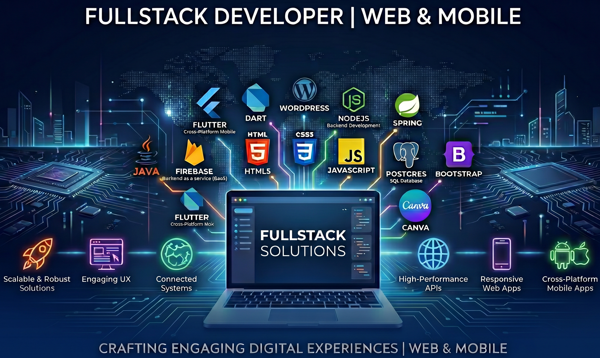

Hi 👋, I'm Francesco Procacci, a FullStack Developer based in Perugia, Italy! 
I have a solid background in web and mobile development, gained through my university education and my work experiences.
I have a keen eye for details and aesthetics. My passion lies in creating engaging user experiences, and I am always eager to explore new technologies!

# Skills:

🚀 Build robust, scalable web solutions using cutting-edge frameworks and technologies.

💻 Design engaging and intuitive user experiences through thoughtful design and smooth interaction.

🌐 Develop high-performance APIs and efficient backend systems to ensure flawless application functionality.

📱 Create fully responsive web applications that deliver an optimal user experience across every device.

📲 Build cross-platform mobile applications for iOS and Android, ensuring performance and usability on the go.

# 💻 Tech Stack:

 

 
 
 
 

 

 

## 📱 Contact Me

